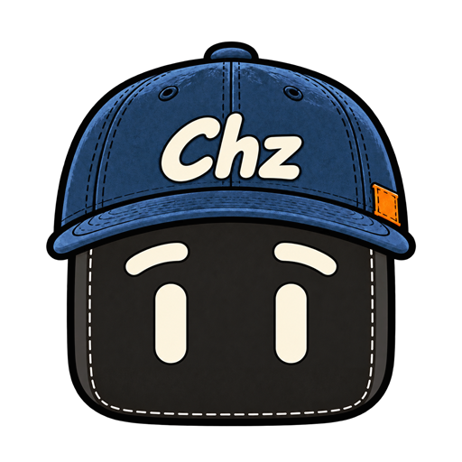

# 你好，我是小谁 👋

我是陈震，关注 AI、科技与独立开发。

边学习，边动手做。这里放自己做的工具，也记下做事时遇到的问题和踩过的坑。

## 最近在做

- **[元舵 Tunenomics](https://www.tunenomics.com/)**：我的 OPC 公司，正在一步步把想法做成能用的东西。
- **[TuneMeter · 元舵用量计](https://github.com/imxiaowho/tunenomics-tunemeter)**：离线采集本机 Agent 用量，生成默认脱敏的汇总提交包。当前发布为 Pre-release，只采集，不换算价格。

## 边做边记

[个人网站](https://imxiaowho.github.io/) · [工作台的五段路](https://imxiaowho.github.io/workbench-footsteps.html)

记录 AI 工具、独立开发，以及做元舵的一些经历。

这个戴帽子的方脑袋叫 xiaowho。帽子上的 Chz，来自我的名字。
